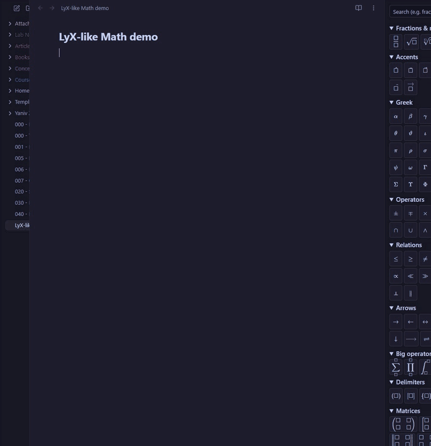

# LyX-like Math

An Obsidian plugin that makes typing math feel like [LyX](https://www.lyx.org/): you edit the
formula as rendered math, `\commands` finish with Space, and wrappers like `\frac` and `\sqrt`
give you empty boxes to fill. Notes stay plain Markdown: formulas are saved as ordinary
`$...$` and `$$...$$` LaTeX, which Obsidian renders as usual.



> This plugin was created by AI ([Claude Code](https://claude.com/claude-code)), directed and
> tested by Omer Cooper.

Desktop only. The math editor is [MathLive](https://cortexjs.io/mathlive/) 0.111.1 (MIT), bundled
with its fonts, so it works offline.

## Keys

| Key | What it does |
|---|---|
| **Ctrl+M** | New inline math `$...$` at the cursor, or edit the formula under the cursor |
| **Ctrl+Shift+M** | New display math `$$...$$`: first choose *Display math* or *Numbered display math* |
| `\name` then **Space** | Finishes the command as typed (no need to pick from a list) |
| `\name` then a symbol | Finishes the command and types the symbol |
| **Tab** | Next empty box; after the last one, leaves the box |
| **Esc** | Close the editor and save, cursor after the formula |
| **←** / **→** at the edge | Leave the formula before / after it |
| **Ctrl+Enter** | In a matrix: add a row |
| **Ctrl+Shift+Enter** | In a matrix: add a column |

Wrappers keep everything you type inside them until Space or Tab: `\sqrt 4*5` gives
`\sqrt{4*5}`. Only LyX behaviour is on: no auto-conversion of `alpha`, `/`, `->`, auto-paired
brackets and so on.

In Live Preview, **clicking a formula** opens it in the editor. Formulas the editor can't handle
(`aligned`, `\label`, multi-line blocks, unknown macros) are left alone and open as LaTeX text,
with a short notice.

## Saved LaTeX

- Braces are always written: `\frac{4}{3}`, `\sqrt{2}`, `x^{2}`, never `\frac43` or `x^2`.
- A formula you open and close without changing keeps its original text exactly.
- Empty boxes are saved empty (`\frac{1}{}`).
- Display math is saved as `$$` / formula / `$$` on their own lines.
- Matrices are saved on one line: `\begin{pmatrix}a & b\\ c & d\end{pmatrix}`.

## Numbered equations

Choosing *Numbered display math* adds `\tag{n}`. Numbers count the note's numbered equations
from the top, so inserting or deleting one renumbers the rest. Ctrl+Shift+M on an existing
display equation lets you switch numbering on or off. The command **Renumber equations** fixes
numbers after you edit tags by hand.

## Formula panel

The **Σ** ribbon icon (or the command **Open LyX formula panel**) opens a sidebar of symbol
buttons grouped like LyX's math toolbar: fractions & roots, accents, Greek, operators,
relations, arrows, big operators, delimiters, matrices, functions, misc. There's a search box at the top (`\` optional).
Clicking a button inserts into the open editor with the cursor in the first empty box; with no
editor open, it starts inline math at the note's cursor. The Matrices group also has **+ row**
and **+ column** buttons.

## Settings

**Copy unsaved formulas to the clipboard** (on by default): if the note changes while you are
editing a formula (it syncs, or its tab is closed), the formula can't be saved into it. It is
always shown in a message; with this on, it is also copied to the clipboard so you can paste it
back. This is the only clipboard access by the plugin, and it never reads the clipboard.

## Install

**From Obsidian** (once the plugin is listed): Settings → Community plugins → Browse → search
for **LyX-like Math** → Install → Enable.

**Manually:** download `main.js`, `manifest.json` and `styles.css` from the
[latest release](https://github.com/OmerCooper/lyx-like-math/releases/latest), put them in
`<your vault>/.obsidian/plugins/lyx-like-math/`, then in Obsidian: Settings → Community plugins
→ reload the list and enable **LyX-like Math**. The math fonts are inside `styles.css`; nothing
is downloaded at run time.

**With [BRAT](https://github.com/TfTHacker/obsidian42-brat):** add the beta plugin
`OmerCooper/lyx-like-math`.

Ctrl+M and Ctrl+Shift+M can be changed under Settings → Hotkeys (search "math").

## Development

Needs Node.js 18 or later.

```sh
npm install
npm run build       # main.js and styles.css
npm run deploy      # build + copy to your vault: put the plugin folder path in deploy-target.txt
npm test            # unit tests (vitest)
npm run e2e         # browser tests: real MathLive and CodeMirror in local Chrome (playwright-core)
npm run dev         # rebuild on change
```

To release: bump the version in `manifest.json`, `package.json` and `versions.json`, commit, then
push a tag with the same version (`git tag 0.2.0 && git push origin 0.2.0`). GitHub Actions
builds and publishes the release.

Design and plan: `docs/superpowers/specs/2026-10-26-lyx-math-design.md`,
`docs/superpowers/plans/2026-10-27-lyx-math.md`.
